# Supermarket

Setup instructions and API reference for the Angular frontend and NestJS backend. MongoDB stores users, products, carts, and orders; Redis shares authentication rate limits across replicas; MinIO/S3 stores uploaded images and generated invoices.

## Screenshots

The storefront, customer checkout flow, and administrator workspace are shown below.

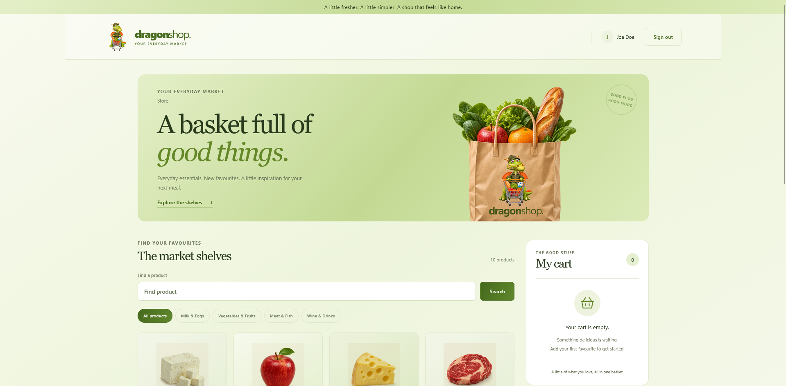

<details>
<summary>Sign in and signup</summary>

**Sign in**

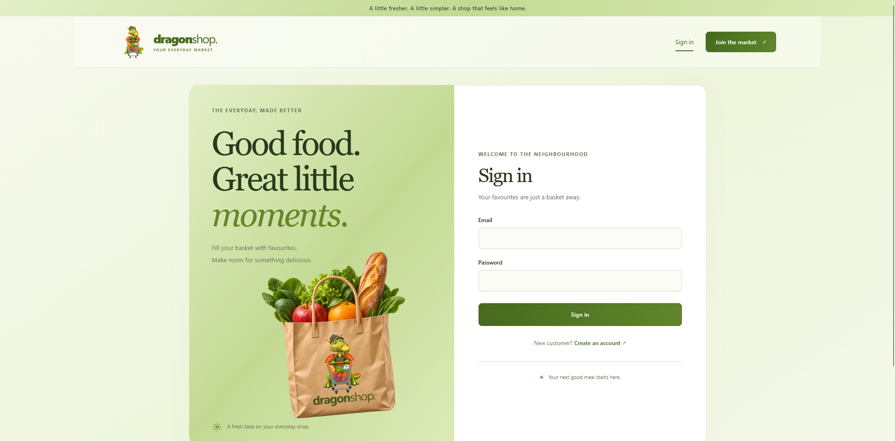

**Signup: account details**

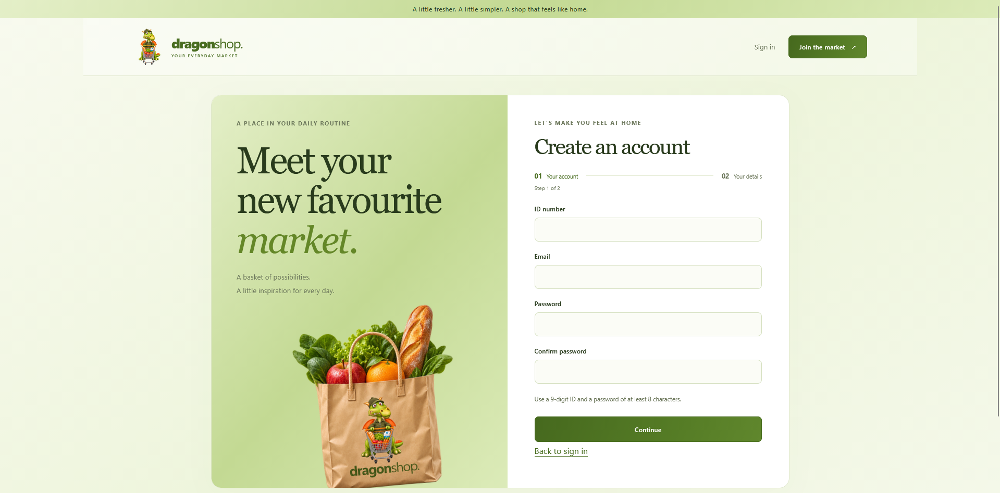

**Signup: personal details**

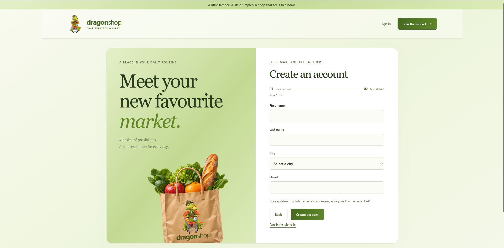

</details>

<details>
<summary>Customer welcome and shopping history</summary>

**First visit**

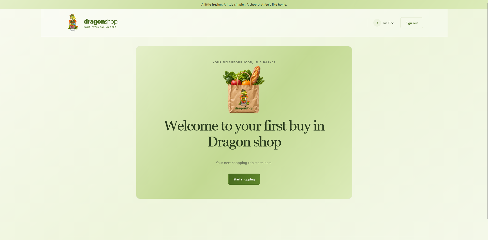

**Returning customer with an open cart**

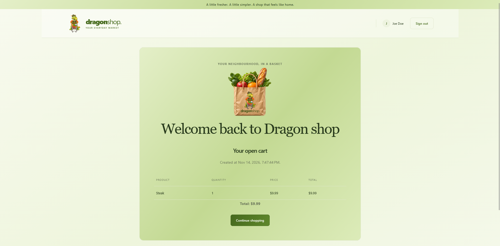

**Returning customer with a previous order**

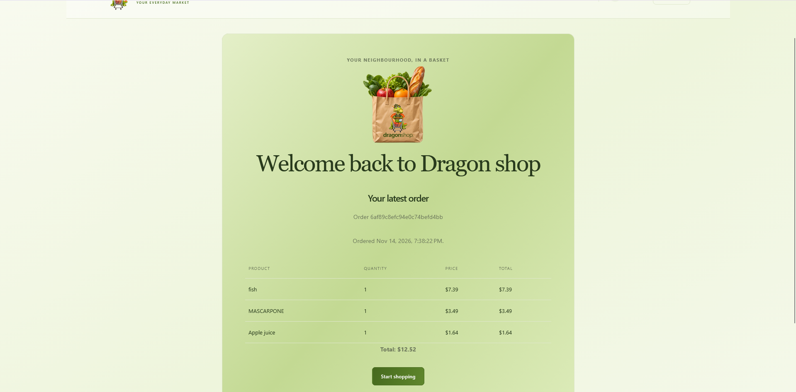

</details>

<details>
<summary>Shopping and order review</summary>

**More of the storefront**

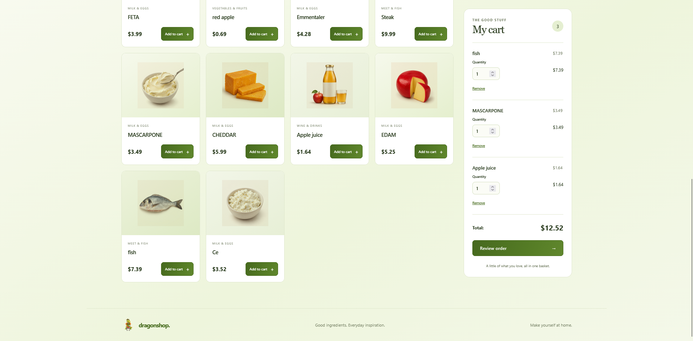

**Order review**

Use **Find products** beside the heading to highlight the entire product name when it contains the search text. Matching is case-insensitive; all rows remain visible, and clearing the field removes the highlights. Cart contents and the checkout total stay unchanged.

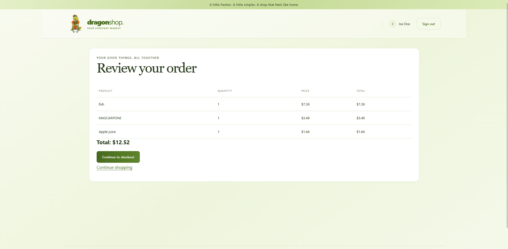

</details>

<details>
<summary>Checkout, confirmation, and invoice</summary>

**Checkout**

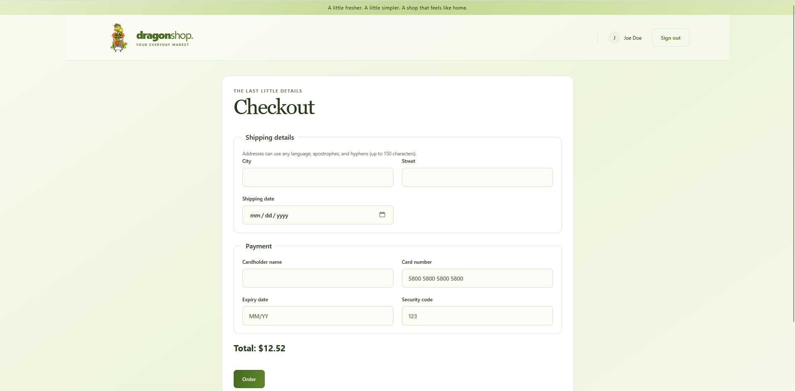

**Order confirmation**

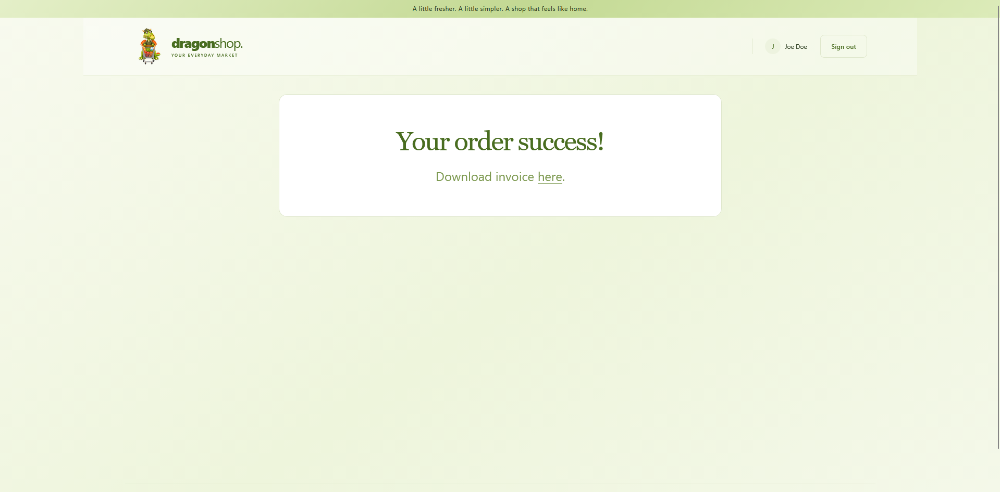

**Invoice**

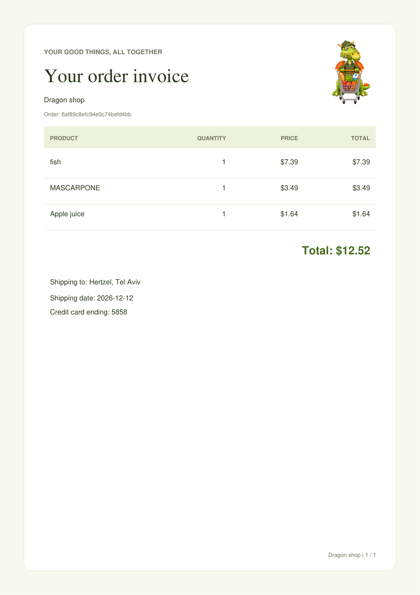

</details>

<details>
<summary>Administrator product management</summary>

**Add a product**

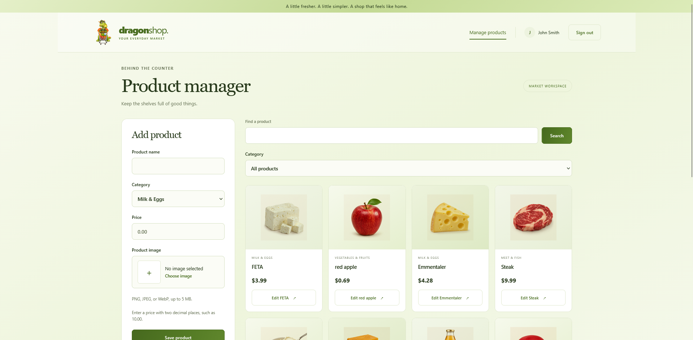

**Edit a product**

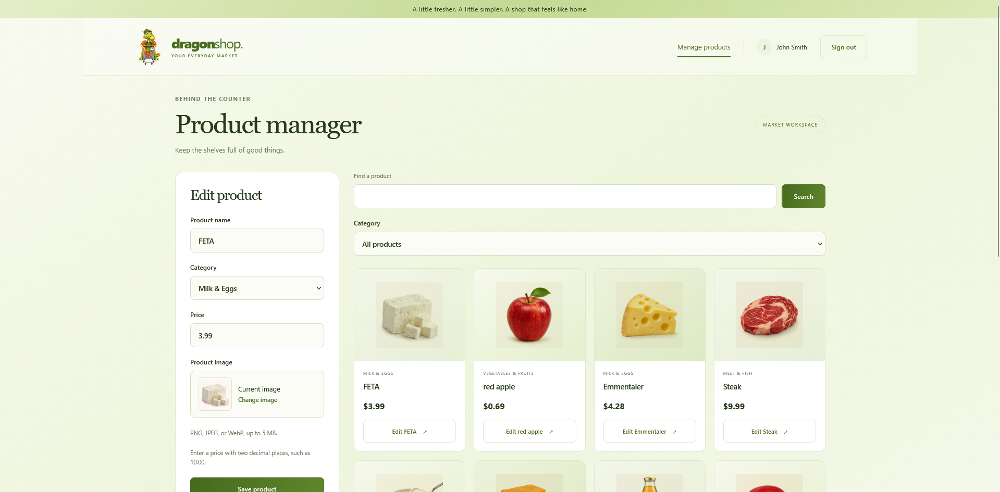

**Delete a product**

Choose **Delete** to open a confirmation naming the product. Select **Yes** to remove it or **No** to cancel.

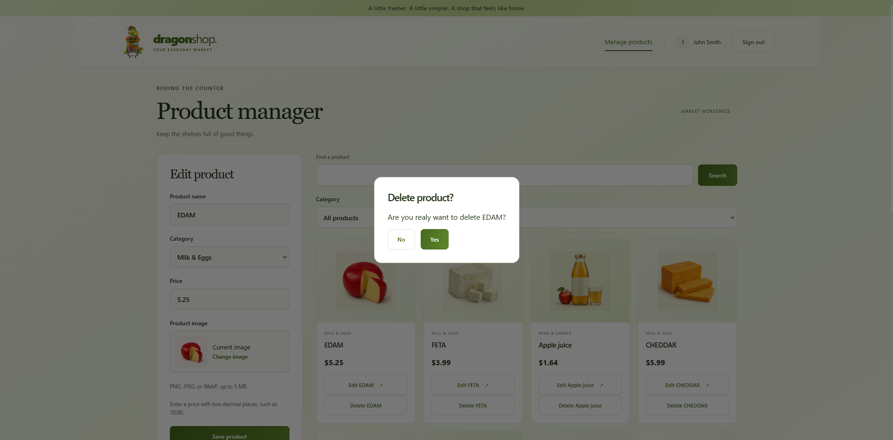

</details>

## Database setup

Docker Compose initializes the `shop` database automatically on the first start with an empty MongoDB volume. For a database managed outside Compose, create `shop` and import the collections from the [db/seeds](db/seeds/) directory:

- `carts.json`
- `orders.json`
- `products.json`
- `users.json`

## Administrator login

The seeded demo administrator credentials are:

| Field    | Value                 |
| -------- | --------------------- |
| Username | `j.smith@example.com` |
| Password | `sec907@Ad0`          |

## Project structure

```text
backend/
  src/
    controllers/ HTTP endpoints
    services/    Authentication, products, carts, checkout, images, invoices, and CSRF tokens
    models/      MongoDB schemas
    modules/     Application wiring and database connection
    guards/      Session, role, CSRF, and authentication rate-limit checks
    stores/      Redis rate-limit storage
    types/       Request and data contracts
    utils/       Invoice PDF generation
    config/      Environment loading
  tests/       Jest HTTP tests with mocked models and MongoDB/Redis/MinIO integration tests
frontend/
  src/         Angular 22 standalone components, services, forms, routes, and unit tests
  src/app/
    components/ One directory per component, with TypeScript and HTML files; optional local SCSS
    pages/      One directory per route-level page, with TypeScript and HTML files; optional local SCSS
    services/   API, authentication, and cart services
    models/     API contracts and typed checkout form
    guards/     Route access guards
    routes/     Application route definitions
    validators/ Form validation rules
    constants/  Product categories
    utils/      Error formatting
    tests/      Frontend unit and rendering tests
  src/styles/  Global SCSS partials for theme, base elements, forms, layouts, and feature styling
  e2e/         Playwright browser tests
docs/
  screenshots/ Customer and administrator screenshots used in this README
db/
  Dockerfile   MongoDB image definition
  01-import.sh Database initialization script
  seeds/       Database seed collections
integration_tests/
  Dockerfile   Non-root integration-test runner
minio/
  Dockerfile   MinIO server built from pinned source
redis/
  Dockerfile   Redis image with a health check and non-root user
  redis.conf   Persistence and rate-limit memory configuration
.github/
  workflows/   Tests, security scans, and report artifacts
```

Use Node.js 26.13.1 LTS (`.nvmrc`), also pinned in Docker and GitHub Actions. All project manifests require the Node.js 26 line starting at 26.13.1; Node.js 25 is unsupported. Install dependencies with `npm ci --prefix backend` and `npm ci --prefix frontend`. Set up MongoDB, Redis, MinIO/S3, and a session signing key. Before the first local start or after upgrading to a release that adds indexes, build the backend and provision indexes against the same `MONGODB_URI` that the app uses:

```sh
npm --prefix backend run build
npm --prefix backend run db:indexes
npm start
```

Startup verifies the required MongoDB indexes and waits for Redis before accepting requests. The index command creates missing indexes and preserves existing ones. With `S3_CREATE_BUCKET=true`, the backend also checks or creates the storage bucket at startup. Startup builds the Angular application into `frontend/dist/browser` and compiles NestJS into `backend/dist`. NestJS serves the built frontend and API at `http://localhost:3000`, keeping session cookies on the same origin.

The frontend uses Angular 22, TypeScript 6, standalone components, reactive forms, signals, HttpClient, and role-based route guards. AngularJS, UI Router, jQuery, and their old templates have been removed. Hash routing keeps frontend URLs separate from API endpoints; old `#!/` bookmarks are normalized to `#/`. Product listing, category filtering, search, administrator add/edit/delete, two-step signup with email/ID availability checks, login, session reconnect, and saved carts use the existing API. Cart state is restored from MongoDB rather than the old browser localStorage format. Checkout collects city, street, shipping date, and demo credit-card details, then saves the order and closes the cart. Demo checkout does not charge a card.

For frontend development, keep the Compose application running on port 3000 (or run a separately configured local backend) and run `npm --prefix frontend start` in another terminal. Open `http://localhost:4200`; the Angular development server proxies API calls to NestJS. Change `frontend/proxy.conf.json` if the backend uses a different port. The Docker backend issues Secure cookies because it runs in production mode; for development over HTTP outside localhost, use a local backend without `NODE_ENV=production`, or configure HTTPS. Run `npm run build` from the root to build both projects without starting them.

Bundled catalog photos live in `backend/static/products` and remain public at `/products/<filename>.png`. Administrator uploads are saved in the private MinIO `product-images` bucket as part of a product save. The backend streams attached images at `/products/uploads/<generated-filename>`. The bucket is created automatically when `S3_CREATE_BUCKET=true`, as configured in `.env.example`. AWS deployments also need `s3:DeleteObject` permission for managed product images.

Both Compose files build MinIO from the pinned upstream `RELEASE.2025-09-07T16-13-09Z` source using `minio/Dockerfile`, avoiding the unavailable prebuilt image repositories. The first build downloads Go dependencies and compiles the server, so it takes longer; later local builds reuse Docker layers. The MinIO image includes its health check and runs as UID/GID 1000. Existing MinIO data volumes must be writable by this user.

Compose stores MinIO objects in the named `minio_data` volume and no longer mounts product directories into the app. Copy `.env.example` to `.env` and choose your own MinIO credentials. All S3 client settings are defined in `.env`, which Compose loads through `env_file`; AWS credentials reference the MinIO credentials by default. The MinIO console is bound to `127.0.0.1` and available locally at `http://localhost:9001`; its API stays inside the Compose network. The backend uses the official `@aws-sdk/client-s3` package. It accepts `S3_ENDPOINT` (a full URL), `S3_FORCE_PATH_STYLE`, `S3_CREATE_BUCKET`, `S3_BUCKET` (default `product-images`), and `AWS_REGION` (default `us-east-1`). Credentials use the standard AWS provider chain, including `AWS_ACCESS_KEY_ID`, `AWS_SECRET_ACCESS_KEY`, optional `AWS_SESSION_TOKEN`, and IAM roles. Compose supplies the MinIO endpoint, credentials, path-style addressing, and automatic bucket creation. For a backend running outside Docker, configure them to point to an accessible MinIO instance; port 9000 is not published by the default Compose file.

For AWS S3, provision the bucket first, set `S3_BUCKET` and `AWS_REGION`, omit `S3_ENDPOINT`, and leave `S3_FORCE_PATH_STYLE` and `S3_CREATE_BUCKET` unset or `false`. Provide an IAM role or AWS credentials with object read/write permissions. Update these values in `.env` when deploying against AWS; the example defaults target the local MinIO service.

Existing uploaded files are not automatically migrated or deleted. Keep the old `product_uploads` volume and locally uploaded files until migration is verified. Copy legacy files into the MinIO bucket using their generated filename as the object key. Existing `/products/uploads/<filename>` URLs then work unchanged. Older records using `/products/<generated-filename>` must be updated to `/products/uploads/<generated-filename>` after copying their images. Bundled catalog records need no changes. Do not run `docker compose down --volumes` if you need to preserve database, signing-key, Redis rate-limit, or MinIO data.

The backend uses NestJS 12 with its Express HTTP adapter and TypeScript 7. It keeps CommonJS application output with NodeNext module resolution so Node.js can load NestJS 12's ESM packages. Routing is handled by the authentication, products, carts, and orders controllers, authentication to `AuthService` and `SessionGuard`, product catalog queries and line-item validation to `ProductsService`, cart operations to `CartsService`, and checkout/order queries to `CheckoutService`. `DatabaseModule` connects to MongoDB and injects models. The old Express routers and middleware have been removed. JSON API routes are grouped under `/api`. Authentication uses the `SESSIONID` cookie. Existing JWT sessions remain accepted; new tokens contain the user ID, a returning-login flag, and standard timestamps. Checkout supports demo orders without real payment processing.

## Docker

Copy `.env.example` to `.env`, choose your MinIO credentials, then start MongoDB, Redis, MinIO, and the application from the project root:

```sh
docker compose up --build -d --wait
```

Open `http://localhost:3000`. The multi-stage app image compiles Angular and NestJS, then includes the built frontend and production backend dependencies. MongoDB is available only inside the Compose network. Its image imports the four `db/seeds/*.json` files into `shop` when the database volume is first initialized. Existing database volumes are preserved and are not reimported.

MongoDB data, Redis append-only files, MinIO objects, and the generated session-signing key are stored in the named volumes `mongodb_data`, `redis_data`, `minio_data`, and `app_keys`. Stop the containers while retaining these volumes with `docker compose down`. View logs with `docker compose logs -f`.

Compose runs the one-shot `db-indexes` service after MongoDB is healthy. The app starts after provisioning succeeds. See `docker compose logs db-indexes` if provisioning fails.

The application is published on the configured `PORT` (3000 in `.env.example`), and the MinIO console is published at `http://localhost:9001`. MongoDB (27017), Redis (6379), and the MinIO API (9000) are reachable only inside the Compose network. A backend running directly on the host needs independently reachable service endpoints or explicit development port mappings.

The MongoDB image runs as `mongodb:mongodb` (UID/GID 999), including initialization and health checks. New named volumes inherit the image's data-directory ownership; integration tests explicitly give their temporary data directory UID/GID 999. Existing volumes and bind mounts must already be writable by this user because startup no longer runs as root to repair ownership.

The application and integration tests build `db/Dockerfile`, based on MongoDB **9.0.8**, pinned to the latest stable official Docker image verified on November 12, 2026 ([official image tags](https://github.com/docker-library/official-images/blob/master/library/mongo), [release notes](https://www.mongodb.com/docs/manual/release-notes/9.0/)). Both inherit its `mongosh` health check (5-second interval and timeout, 20 retries, 30-second startup period). The backend uses Mongoose 9 with the MongoDB Node.js 7 driver and promise-based queries.

### Existing MongoDB 4.4 data

Compose mounts the named volume `mongodb_data` at `/data/db` (normally `<compose-project>_mongodb_data`). A new, empty volume is initialized with the seed catalog; an existing volume is reused without reimporting seeds. Compose does not create a separate volume for MongoDB 9 or automatically migrate existing data. If this volume contains MongoDB 4.4 data, do not start MongoDB 9 against it. Keep the original volume until migration and verification are complete.

To preserve an existing database, stop application writes, back up the 4.4 deployment, and test the supported staged upgrade on a copy of its data: **4.4 -> 5.0 -> 6.0 -> 7.0 -> 8.0 -> 9.0**. At each stage, follow that release's standalone upgrade procedure, verify the database, and set the required feature compatibility version before continuing. MongoDB documents the [9.0 upgrade prerequisites and procedure](https://www.mongodb.com/docs/manual/release-notes/9.0-upgrade-standalone/), including the requirement to reach 8.0 or 8.3 first. Transfer the validated upgraded data into the new deployment only after backup and testing; changing the image tag alone does not migrate the old volume. These repository changes do not run a live data migration.

The backend accepts `MONGODB_URI` (defaults to `mongodb://localhost:27017/shop`), `REDIS_URL` (defaults to `redis://127.0.0.1:6379`), `PORT` (defaults to `3000`), and `JWT_KEY_PATH` (defaults to `backend/src/key.pem` when run directly). Compose sets these automatically and creates the signing key on first startup. For local startup, create a key once with `node -e "require('node:fs').writeFileSync('backend/src/key.pem', require('node:crypto').randomBytes(64).toString('hex'), {flag:'wx', mode:0o600})"`.

Copy `.env.example` to `.env` in the repository root before starting Compose. Compose reads `PORT`, `MONGODB_URI`, `REDIS_URL`, `JWT_KEY_PATH`, and `MONGO_INITDB_DATABASE` using `${VARIABLE}` interpolation. The example values are configured for Docker; `PORT` controls both the published port and the application listener. Keep the database name as `shop` to match the seed import script.

For local `npm start`, point `MONGODB_URI` and `REDIS_URL` to reachable MongoDB and Redis instances, configure `S3_ENDPOINT` and storage credentials for an accessible MinIO service (or use AWS S3), and set `JWT_KEY_PATH` to the absolute path of an existing local signing key. Relative key paths resolve from the backend process's working directory, normally `backend`, so `src/key.pem` refers to the key generated above. The backend also loads the root `.env` automatically, regardless of the working directory, using the configured Node.js 26 runtime. Existing environment variables take precedence; a missing `.env` is allowed. `.env` is ignored by Git and excluded from Docker images.

Node's `.env` loader does not expand `${VARIABLE}` references. When running the backend directly, set `AWS_ACCESS_KEY_ID` and `AWS_SECRET_ACCESS_KEY` to the actual MinIO credentials rather than the interpolation expressions in `.env.example`. Docker Compose expands those expressions for container startup.

Global styling is organized as SCSS partials under `frontend/src/styles/`, loaded in cascade order by `frontend/src/styles.scss` using `@use`. Theme variables live in `_variables.scss`. Components and pages keep their own directory with separate TypeScript and HTML files; a local SCSS file is included only when it contains component-specific rules.

## Formatting

Install the root development tools with `npm ci`, then run `npm run format` to format the project's TypeScript, Angular templates, SCSS, HTML, JSON, YAML, and Markdown files. Run `npm run format:check` to check formatting without changing files. Shared rules live in `.prettierrc.json` and `.editorconfig`.

Generated files, dependency lockfiles, credentials, image assets, and MongoDB's newline-delimited seed collections are excluded from automatic formatting.

## Tests

Tests require Node.js 26.13.1 or newer within the 26.x line. All application code, backend models, startup scripts, and tests use TypeScript. Backend source compiles into `backend/dist`; backend tests compile separately into `backend/tests-dist`, and Jest loads its compiled configuration from `backend/dist/jest.config.js`. The backend test command enables Node's VM module support for NestJS 12 dependencies. Frontend tests use Vitest 5 and jsdom 31. Angular packages are aligned at 22.2.6; frontend TypeScript stays at 6.0.3 because Angular 22 requires TypeScript >=6.0 <6.1 ([compatibility table](https://angular.dev/reference/versions)).

Backend tests compile TypeScript, start a NestJS test application, and exercise HTTP endpoints with Jest and Supertest. Frontend tests use Angular TestBed, HttpTestingController, Vitest, and jsdom. No separately running backend, MongoDB, Redis, or MinIO instance is needed for these unit/HTTP suites; their external dependencies are mocked.

Install both projects' dependencies from the root before the first run:

```sh
npm ci --prefix backend
npm ci --prefix frontend
```

Run both backend and frontend tests from the project root:

```sh
npm test
```

Run either suite separately from the project root:

```sh
npm run test:backend
npm run test:frontend
```

- Backend tests exercise static frontend serving, product listing/search/category queries, validation, counts, signup email/ID availability and password hashing, JWT login/reconnect, expired or malformed tokens, logout, role guards, administrator product deletion, cart ownership, checkout recovery, invoice generation, and order history.
- Frontend tests exercise Angular price/email/password confirmation validators, page titles, navigation permissions, session reconnect, logout success/failure handling, API compatibility, cart persistence/totals, signup duplicate checks and token recovery, order-review name highlighting, and rendered login/signup forms. These replace the old AngularJS directive tests; they are not identical tests.

Backend tests exercise real NestJS HTTP routing, guards, cookie handling, and JWT verification with injected MongoDB model doubles. They do not verify MongoDB persistence. Root `npm run test:backend` builds the Angular frontend first so static-serving tests have a production bundle. GitHub Actions installs both projects' dependencies and runs both suites on pushes and pull requests.

Integration tests in `backend/tests/integration.test.ts` exercise the real API and MongoDB persistence for signup/login, permissions, products, carts, and logout. With Docker running, use these commands from the project root:

```sh
docker compose -p supermarket-integration -f integration.compose.yml up --build --abort-on-container-exit --exit-code-from tests
docker compose -p supermarket-integration -f integration.compose.yml down --volumes
```

The suite uses isolated MongoDB, Redis, and MinIO containers with temporary data and a separate signing key. Its S3 settings and disposable credentials live in `integration_tests/.env.integration`, independently of the local `.env`. It also verifies shared Redis counters and expiry, duplicate email/ID checks, product deletion persistence, concurrent checkout, invoice persistence and ownership, and uploaded images served through the API. The test runner runs as the non-root `node` user. It explicitly uses `HEALTHCHECK NONE` with a documented `CKV_DOCKER_2` exception: this is a one-shot process whose exit code determines success, rather than a long-running service. MongoDB, Redis, and MinIO retain their image-defined health checks. GitHub Actions runs the suite in the integration job and always cleans up the containers.

With Docker Compose running and Google Chrome installed, run `npm --prefix frontend run test:e2e` for Playwright browser tests. Customer signup/cart/checkout operations and administrator image editing/deletion use mocked API responses to avoid changing database records. The administrator smoke test uses the documented demo login against the running backend and reads products without editing them. Override `E2E_BASE_URL` if the app is not on port 3000. For Playwright's bundled browser, run `npx playwright install chromium` from `frontend` and set `PLAYWRIGHT_CHANNEL=chromium`. Tests write HTML reports to `frontend/playwright-report` and JUnit XML to `frontend/test-results/junit.xml`, retaining traces and screenshots on failure. They run in their own CI job with Chromium and a fresh Compose deployment; CI retries failed tests twice and rejects focused `test.only` tests.

## Continuous integration and security scans

[`.github/workflows/main.yml`](.github/workflows/main.yml) runs on pushes, pull requests, and manual dispatches. Jobs run independently:

| Job                 | Scope and output                                                                                                                                                                                                  |
| ------------------- | ----------------------------------------------------------------------------------------------------------------------------------------------------------------------------------------------------------------- |
| Unit/HTTP tests     | Angular and NestJS tests, test logs, and compiled frontend/backend builds.                                                                                                                                        |
| Integration tests   | Real MongoDB, Redis, and MinIO, including shared limits, signup checks, deletion, checkout, and invoices; test logs and container diagnostics.                                                                    |
| Playwright          | Browser flows against the application; HTML/JUnit reports, failure traces/screenshots, and container diagnostics.                                                                                                 |
| CodeQL              | Backend/frontend TypeScript with extended security queries, configured in [`.github/codeql-config.yml`](.github/codeql-config.yml); SARIF results.                                                                |
| NodeJsScan          | Compiled backend JavaScript in `backend/dist`; SARIF results. TypeScript is compiled first because the scanner's default file selection targets JavaScript.                                                       |
| Semgrep TypeScript  | `p/typescript` rules against `backend/src` and `frontend/src`; JSON results and logs.                                                                                                                             |
| npm audit           | Separate root, backend, and frontend lockfile audits, including development dependencies; JSON results and logs.                                                                                                  |
| Dockerfile security | Independent Checkov, Semgrep (`p/dockerfile`), and Trivy configuration scans of `Dockerfile`, `db/Dockerfile`, `minio/Dockerfile`, `redis/Dockerfile`, and `integration_tests/Dockerfile`; JSON results and logs. |

Reports upload as workflow artifacts even when their scan/test step fails and are retained for 14 days. Files are available only if the producing step reached report generation. CodeQL and NodeJsScan also upload SARIF to GitHub code scanning, which must be enabled for the repository. CodeQL reports alerts; it does not automatically fail the job solely because alerts exist. Semgrep fails on findings or scan errors, NodeJsScan fails on warning/error findings, and Checkov/Trivy fail on unsuppressed findings.

npm audit uses `--audit-level=moderate`: moderate, high, and critical findings fail the job; info and low findings remain in the report without failing it. This threshold applies only to npm audit. Jest remains on version 30; scoped dependency overrides select patched `glob` and `minimatch` releases. The outstanding low-severity `deepmerge` advisory in Jest's dependency tree is still reported, not fixed by the threshold. Do not use `npm audit fix --force` to resolve it by downgrading Jest.

## API reference

API paths are relative to the backend origin (`http://localhost:3000` by default). `/api/auth/csrf-token`, `/api/auth/login`, `/api/auth/signup/availability`, `/api/auth/signup`, and uploaded product images at `/products/uploads/<filename>` are public; bundled product images are also public static files. Other API endpoints require the `SESSIONID` cookie set by login. Role `0` is a customer; role `1` is an administrator. Missing, invalid, or expired sessions and rejected login credentials return HTTP 401 with `{ "success": false }`. Authenticated users with the wrong role receive HTTP 403 with the same body, including administrators attempting customer-only checkout. Application-level validation failures also generally return HTTP 200; upload errors use HTTP error statuses.

### Products

| Method | Path                        | Description               |
| ------ | --------------------------- | ------------------------- |
| POST   | `/api/products/create`      | Create a product.         |
| POST   | `/api/products/update`      | Edit a product.           |
| POST   | `/api/products/delete`      | Delete a product (admin). |
| POST   | `/api/products/search`      | Find products by name.    |
| GET    | `/api/products`             | Get all products.         |
| POST   | `/api/products/by-category` | Get products by category. |

#### Create or edit a product

`POST /api/products/create` and `POST /api/products/update` require an administrator session. Both accept:

```json
{
  "name": "apple juice",
  "category": "Wine & Drinks",
  "price": "10.00",
  "image": "..."
}
```

Response:

```json
{
  "success": true
}
```

For `/api/products/update`, include an additional `id` field containing the product's MongoDB ObjectId. Prices must be nonnegative, have exactly two decimal places, and fit within safe integer cents. Send prices as strings (for example, `"10.00"`) to preserve trailing zeros. Category must be one of `Milk & Eggs`, `Vegetables & Fruits`, `Meet & Fish`, or `Wine & Drinks`.

#### Delete a product

`POST /api/products/delete` requires an administrator session and a valid CSRF token. Send `{ "id": "<product ObjectId>" }`. It returns `{ "success": true }` when a product is deleted, or `{ "success": false }` for an invalid or missing product. Customers receive HTTP 403. In the product manager, **Delete** opens a confirmation naming the product; **Yes** deletes it and refreshes the catalog, while **No** or Escape cancels. Saved orders and invoice snapshots are preserved. An open cart containing a deleted product must be updated before checkout.

#### Upload a product image

To attach a file, send the product fields and an `image` file (PNG, JPEG, or WebP, up to 5 MB) as multipart form data to `POST /api/products/create` or `POST /api/products/update`. Include `id` for updates. The saved upload URL appears in the catalog. A JSON update can keep the product's current upload by sending its existing URL or omitting the image field. Replacing an upload or deleting its product removes the old object. Bundled images and external URLs are supported as JSON image values.

#### Find a product

`POST /api/products/search`

Request:

```json
{
  "name": "apple juice"
}
```

The request also accepts `product` instead of `name`. Search is case-insensitive and treats the input as literal text.

Response:

```json
{
  "success": true,
  "products": [
    {
      "name": "apple juice",
      "category": "Wine & Drinks",
      "price": 10,
      "image": "...",
      "id": "..."
    }
  ]
}
```

#### Get all products

`GET /api/products`

No request parameters are needed. The response uses the same product fields as the search and category endpoints.

#### Get products by category

`POST /api/products/by-category`

Request:

```json
{
  "category": "Wine & Drinks"
}
```

The response has the same `success` and `products` structure shown for `/api/products/search`, with matching products in the array.

### Users and sessions

| Method | Path                            | Description                      |
| ------ | ------------------------------- | -------------------------------- |
| POST   | `/api/auth/login`               | Log in.                          |
| POST   | `/api/auth/logout`              | Log out (CSRF protected).        |
| GET    | `/api/auth/session`             | Reconnect a user session.        |
| POST   | `/api/auth/signup`              | Create a customer account.       |
| POST   | `/api/auth/signup/availability` | Check email and ID availability. |

#### Log in

`POST /api/auth/login`

Request:

```json
{
  "username": "j.smith@example.com",
  "password": "sec907@Ad0"
}
```

Response:

```json
{
  "success": true,
  "role": 1,
  "name": "John Smith",
  "user": "...",
  "address": { "city": "...", "street": "..." },
  "isReturning": true
}
```

The response's `user` field contains the user's `_id`; `address` contains the saved address, and `isReturning` controls the welcome greeting. Successful login sets an HTTP-only `SESSIONID` cookie with a JWT valid for nine hours. The cookie includes `Secure` when `NODE_ENV=production` (including the Docker image), so deployed environments must serve the application over HTTPS. Local development without production mode supports HTTP. Invalid credentials return HTTP 401 with `{ "success": false }`.

#### Log out

`POST /api/auth/logout`

Send an empty JSON body with the CSRF header described below.

Response:

```json
{
  "success": true
}
```

#### Reconnect

`GET /api/auth/session`

No request parameters are needed. The response has the same profile fields as login, including the display name as a string.

#### Check signup availability

`POST /api/auth/signup/availability` accepts `{ "email": "buyer@example.com", "id": "123456789" }` with a valid CSRF token. It returns `success`, `available`, `emailExists`, `idExists`, and a `reason` when either value is already registered. It does not create an account or receive passwords.

The signup **Continue** button checks this endpoint before showing personal details. Duplicate email or ID values keep the user on step one with a specific message. While checking, the button and account fields are locked; failed checks can be retried. Final signup checks both fields again, and MongoDB unique indexes reject concurrent duplicates. Resolve any conflicting records before provisioning the indexes.

#### Sign up

`POST /api/auth/signup`

Request:

```json
{
  "id": "123456789",
  "firstName": "John",
  "lastName": "Bryce",
  "email": "jbt@example.com",
  "pass": "123456789",
  "city": "Tel Aviv",
  "street": "Ha Masger"
}
```

Response:

```json
{
  "success": true
}
```

The ID must contain nine digits and the password must contain at least eight characters. Names and cities accept Unicode letters, combining marks, spaces, apostrophes, and hyphens, without requiring capitalization. Streets also accept numbers and common address punctuation (`.`, `,`, `/`, `#`). These fields are limited to 150 characters; empty or malformed values are rejected. The city field accepts typed values with suggestions. New accounts always receive customer role `0`. Failed signup returns `{ "success": false, "reason": "..." }`.

### Statistics

| Method | Path                  | Description                 |
| ------ | --------------------- | --------------------------- |
| GET    | `/api/orders/count`   | Get the number of orders.   |
| GET    | `/api/products/count` | Get the number of products. |

Both endpoints require a customer session and take no request parameters.

Both endpoints use the same response shape:

```json
{
  "success": true,
  "count": 1
}
```

### Carts and order history

All of these endpoints require a customer session and operate on that customer's records.

| Method | Path                 | Request                                                         | Description                                         |
| ------ | -------------------- | --------------------------------------------------------------- | --------------------------------------------------- |
| POST   | `/api/carts`         | `{ "products": [{ "id": "<product-object-id>", "count": 1 }] }` | Create an open cart; rejects an existing open cart. |
| POST   | `/api/carts/update`  | `{ "id": "<cart-object-id>", "products": [] }`                  | Replace the contents of the customer's open cart.   |
| GET    | `/api/carts/current` | None                                                            | Return the open cart, if present.                   |
| GET    | `/api/orders/latest` | None                                                            | Return the most recent order, if present.           |

Cart item IDs must identify existing products, quantities must be positive safe integers, and duplicate product IDs are rejected. Prices are taken from the database; client-supplied prices are ignored. An empty product array is allowed.

A unique partial MongoDB index on `user_id` for carts with `status: 1` enforces one open cart per customer, including concurrent requests. Closed carts are unaffected. If existing data contains multiple open carts for a user, provisioning fails until those records are reviewed and the extra carts are closed or otherwise resolved.

The customer welcome page shows the open cart (including an empty open cart), its contents, total, and creation date labeled **Created at**. Without an open cart, it shows the latest order when available and a **Start shopping** button. The welcome heading uses login history: signup marks a new account as not yet logged in, and the first successful login atomically marks it as logged in. Later logins show **Welcome back to Dragon shop** even without prior orders. The signed session retains its greeting across page reloads. Existing accounts and legacy sessions are treated as returning customers.

Cart creation, updates, and retrieval return `{ "success": true, "cart": { "id": "...", "products": [], "createdAt": "..." } }`. The current-cart endpoint returns `cart: null` when there is no open cart. Order history returns the latest order in the same shape as checkout, with `order: null` when no order exists. Older orders may omit fields that were unavailable when they were placed. Customer-only `POST /api/orders/checkout` places demo orders as described below.

## CSRF protection

All API writes, including login, signup, product uploads, and checkout, require a signed double-submit CSRF token. First call public `GET /api/auth/csrf-token` with the session cookie, if present. It returns `{ "success": true }` and sets a readable `XSRF-TOKEN` cookie with `Cache-Control: no-store`. Send that cookie along with an `X-XSRF-TOKEN` header containing the same value on each POST request. A cookie alone is insufficient. Tokens use the shared session-signing key and are bound to the current `SESSIONID`; each replica must use the same signing key.

Angular obtains the token before startup and its built-in HttpClient XSRF protection attaches the header to relative same-origin writes, including multipart uploads. Login replaces it with a session-bound token; POST logout expires the session and issues a fresh anonymous token so another login can work without reloading. Page reloads bootstrap a token for existing sessions. The session cookie remains HTTP-only; only the CSRF cookie is readable by JavaScript. Both cookies use `SameSite=Lax` and `Secure` in production.

If a signup availability check or final signup receives a CSRF verification rejection, the frontend fetches a fresh token and retries that request once. A second rejection is shown to the user; retries do not bypass the server guards. Signup also reports rate-limit waits, connection failures, and temporary service unavailability.

The API rejects `Sec-Fetch-Site: cross-site` writes and validates Origin (or Referer as a fallback). By default, the source host and port must match the request Host. If a reverse proxy rewrites Host, set `CSRF_TRUSTED_ORIGINS` to a comma-separated list of exact browser origins, such as `https://shop.example.com`; wildcards are not supported. Forwarded headers are not trusted. Clients without Origin/Referer must still supply valid cookie/header tokens. Rejected CSRF requests return HTTP 403 without performing the requested write.

## Authentication rate limits

Login allows 20 requests, signup allows 5 requests, and signup availability checks allow 5 requests per connection peer IP address per 15-minute window, with independent limits for each endpoint. All attempts count, including successful and invalid requests. Excess requests return HTTP 429 with `{ "success": false, "reason": "Too many attempts. Please try again later." }` and a `Retry-After` header in seconds. Limits are stored in Redis using an atomic Lua script so application replicas share counters and application restarts preserve active windows. Set `REDIS_URL` to the same Redis instance on every replica (default `redis://127.0.0.1:6379` for direct startup; Compose uses `redis://redis:6379`). Redis expires counters automatically after 15 minutes; rejected attempts do not extend the window. If Redis is unavailable, authentication fails closed with HTTP 503 and `Retry-After: 5`. Both Compose files build `redis/Dockerfile`, which loads `redis/redis.conf`, includes a health check, and runs as the Redis user. The configuration enables append-only persistence and a 128 MB no-eviction memory limit. The private Redis service persists counters in the `redis_data` volume; integration tests use temporary storage. Forwarding headers are ignored to prevent spoofing, so clients behind a reverse proxy share its peer-address limit. For direct local startup, run Redis and override `REDIS_URL` if the root `.env` points to the Compose hostname.

## Demo checkout

Checkout at `/#/order/payment` requires a nonempty customer cart. Enter city, street, today or a future shipping date, cardholder name, any 16-digit card number (spaces are allowed), a current or future expiry month (`MM/YY`), and any three-digit security code. Shipping city and street accept international text, apostrophes, and hyphens, with a 150-character limit each. No charge is made. The browser sends only the card number's last four digits; the full number, expiry, cardholder name, and security code are never sent to the backend or stored in the database.

`POST /api/orders/checkout` requires a customer session and accepts:

```json
{
  "cartId": "<cart-object-id>",
  "reviewedItems": [{ "id": "<product-object-id>", "count": 1, "unitPriceCents": 1050 }],
  "shipping": { "city": "Tel Aviv", "street": "Ha Masger 10", "date": "2099-12-01" },
  "payment": { "method": "credit_card", "last4": "4242" }
}
```

Shipping dates are checked against the shop date in `Asia/Jerusalem`. The backend checks the reviewed product IDs, quantities, and unit prices against the current cart and catalog, then calculates the total server-side. If they differ, it leaves the cart open and returns `{ "success": false, "reason": "...", "review": { "products": [...] } }` so the customer can review the updated items and submit again. A confirmed order uses the prices that matched the customer's review. Success returns `{ "success": true, "order": { "id": "...", "total": 10.50, "createdAt": "...", "products": [{ "id": "...", "name": "...", "count": 1, "price": 10.50 }], "invoiceUrl": "/orders/<order-id>/invoice", "shipping": { "city": "...", "street": "...", "date": "..." }, "payment": { "mode": "demo", "method": "credit_card", "last4": "4242" } } }`. Other validation failures return `{ "success": false, "reason": "..." }`.

Checkout closes the cart and saves an immutable order snapshot in one atomic cart update. An order is then inserted with a unique partial index for demo orders by cart ID. Concurrent requests and retries reuse this snapshot and return the same order, including recovery after an interrupted order insert; an intervening cart edit prevents stale checkout. Only demo payment metadata is stored. Existing order records are retained. Real payments require a provider integration before this feature can charge cards.

The first authorized download generates the invoice in the same green table style as the order review. The PDF uses the saved product names, quantities, and prices from checkout. It is stored privately in the configured S3/MinIO bucket (`S3_BUCKET`, default `product-images`) at `invoices/<order-id>.pdf`. The existing MinIO data volume preserves invoice files. AWS deployments need read/write permission for this prefix as well as product images.

Checkout returns `order.invoiceUrl`, pointing to `GET /orders/<order-id>/invoice`. The success page's **here** link downloads the PDF. The endpoint requires the owning customer's session and sends an `application/pdf` attachment with private, non-cacheable headers. Conditional S3 creation preserves the original PDF during concurrent requests and retries. If invoice storage fails, the customer can retry the download independently of checkout. Products from before name snapshots were added display as `Unavailable product`.
